<div align="center">

# LandLens

### Satellite image analysis in your browser: enhance, classify, measure, compare and report.

A full-stack **Digital Image Processing** platform. Upload a satellite or aerial image and LandLens separates vegetation, water, built-up areas and bare land, measures them in pixels and hectares, detects what changed between two dates, and writes the results into a PDF report.
Everything runs on **classical image-processing algorithms** on your own machine. No trained model, no cloud service and no API key is needed for the analysis itself.


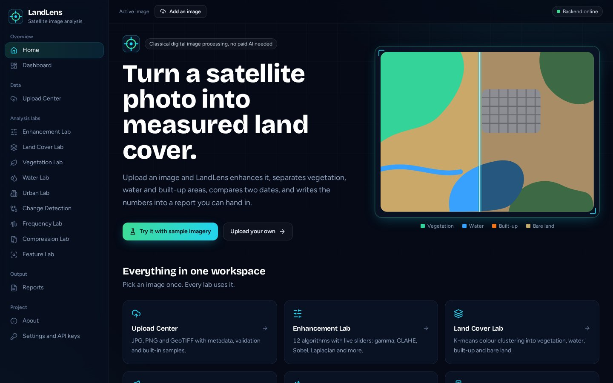

</div>

---

## Table of contents

1. [What LandLens does](#what-landlens-does)
2. [What you can use it for](#what-you-can-use-it-for)
3. [Screenshots](#screenshots)
4. [Quick start](#quick-start)
5. [API keys (optional)](#api-keys-optional)
6. [How to use each page](#how-to-use-each-page)
7. [Algorithms and formulas](#algorithms-and-formulas)
8. [How accurate is it?](#how-accurate-is-it)
9. [Architecture](#architecture)
10. [Project structure](#project-structure)
11. [REST API reference](#rest-api-reference)
12. [Configuration and data storage](#configuration-and-data-storage)
13. [Development](#development)
14. [Deployment](#deployment)
15. [Troubleshooting](#troubleshooting)
16. [Limitations](#limitations)
17. [Roadmap](#roadmap)
18. [Author and license](#author-and-license)

---

## What LandLens does

You give it an image. It gives you measurements.

1. **Upload** a JPG, PNG or GeoTIFF (or load a built-in sample, or fetch imagery by latitude and longitude).
2. **Enhance** it with 12 classic algorithms and live sliders.
3. **Classify** the scene into vegetation, water, built-up and bare land.
4. **Inspect** each class on its own: mask, heatmap, histogram, tile map and connected regions with shape features.
5. **Compare** two dates and see exactly what changed and what turned into what.
6. **Explore** the maths: frequency-domain filtering, image compression and texture or shape features.
7. **Export** a PDF report, a CSV of every number and a log of your analysis history.

### Feature overview

| Module | What it gives you |
|---|---|
| **Upload Center** | Drag-and-drop for JPG, JPEG, PNG, TIFF and GeoTIFF. Dimensions, channels, pixel count, file size, metadata and channel statistics. Three built-in sample scenes. Optional fetch by coordinates (Mapbox). |
| **Enhancement Lab** | Grayscale, negative, log, gamma, contrast stretching, histogram equalization, CLAHE, Gaussian, median and mean filters, Sobel and Laplacian sharpening. Brightness and contrast sliders, side-by-side and swipe views, before and after histograms and statistics. |
| **Land Cover Lab** | K-means colour and texture clustering into four classes. Class map, overlay, per-class masks, area in pixels, percent, hectares and km², cluster table, largest regions per class. |
| **Vegetation Lab** | Greenness mask and heatmap from the Excess-Green index. Threshold, Otsu or K-means. Compare two images. A separate **NDVI mode** computes true NDVI from multispectral files. |
| **Water Lab** | Blue-dominance index with a smoothness filter to avoid confusing water with shadows or rooftops. |
| **Urban Lab** | Built-up score from local texture, edge density and low colour saturation. |
| **Change Detection** | Image registration, resampling, histogram matching, colour difference, change mask, changed area, changed regions, land-cover comparison and a from-to transition table. |
| **Frequency Lab** | 2-D DFT and FFT, magnitude spectrum, ideal, Butterworth and Gaussian low-pass and high-pass filters, filter mask, filtered spectrum and reconstruction. DFT versus FFT timing. |
| **Compression Lab** | JPEG, PNG, run-length encoding and Huffman coding (the last two written from scratch). Compression ratio, size reduction, MSE and PSNR, quality curve and error map. |
| **Feature Lab** | Mean, variance, skewness, entropy, histograms, area, perimeter, circularity, compactness, eccentricity, aspect ratio, bounding boxes, Hu moments, GLCM texture and Local Binary Patterns. |
| **Reports** | Multi-page PDF, CSV export, analysis history and an optional AI-written interpretation. |
| **Dashboard** | Live statistics from your own analyses, recent projects and recent activity. Nothing is hardcoded. |
| **Settings** | A page to paste optional API keys and set the default ground resolution. |

---

## What you can use it for

LandLens is built as a teaching and prototyping tool. Typical uses:

- **Coursework and viva demos.** Every result comes from an algorithm you can explain line by line, and each lab maps to a standard Digital Image Processing topic (point operations, histogram methods, spatial filtering, segmentation, morphology, frequency domain, compression, representation and description).
- **Learning remote sensing.** See how colour indices, thresholds and clustering behave on real imagery, and how NDVI differs from an RGB greenness index.
- **Quick land-cover estimates.** Get a first look at how much of a scene is vegetation, water or built-up, with areas in hectares once you set the metres-per-pixel value.
- **Before and after comparisons.** Deforestation, urban expansion, shrinking lakes, flood extent or crop-cycle differences between two dates of the same place.
- **Vegetation monitoring.** Greenness maps from ordinary photos, and genuine NDVI from 4-band imagery.
- **Algorithm experiments.** Test how Otsu, K-means, morphology kernels or filter cutoffs change a result, with instant visual feedback.
- **Report generation.** Turn an analysis into a presentable PDF and a CSV for a spreadsheet.
- **A base for your own project.** The backend is a clean REST API and the algorithms live in small, readable modules.

> LandLens gives **estimates from colour, intensity and texture**. It is not a certified mapping product, and results should be checked against reference data before any real-world decision. See [Limitations](#limitations).

---

## Screenshots

| | |
|---|---|
| 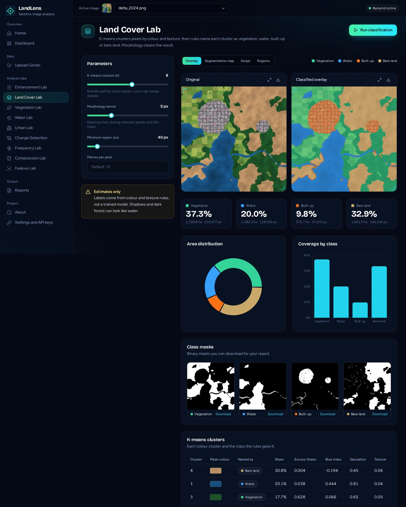 <br> **Land Cover Lab:** classified overlay, areas and class masks | 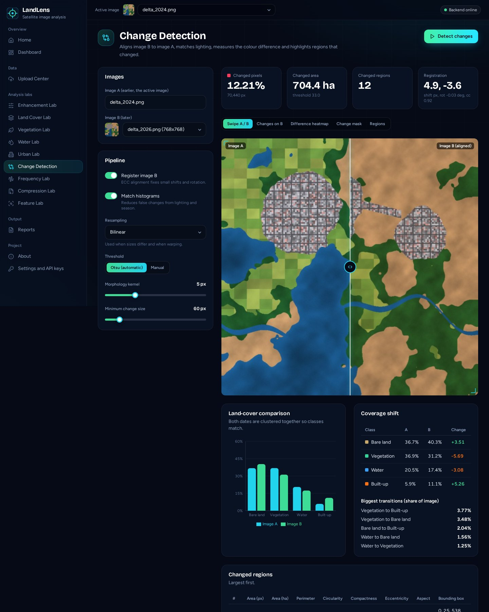 <br> **Change Detection:** swipe, registration, transitions |
| 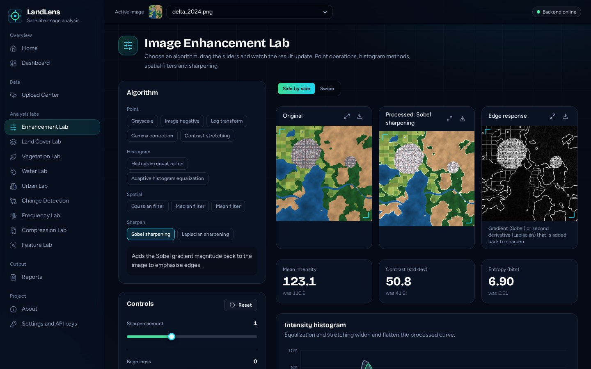 <br> **Enhancement Lab:** Sobel sharpening with edge response | 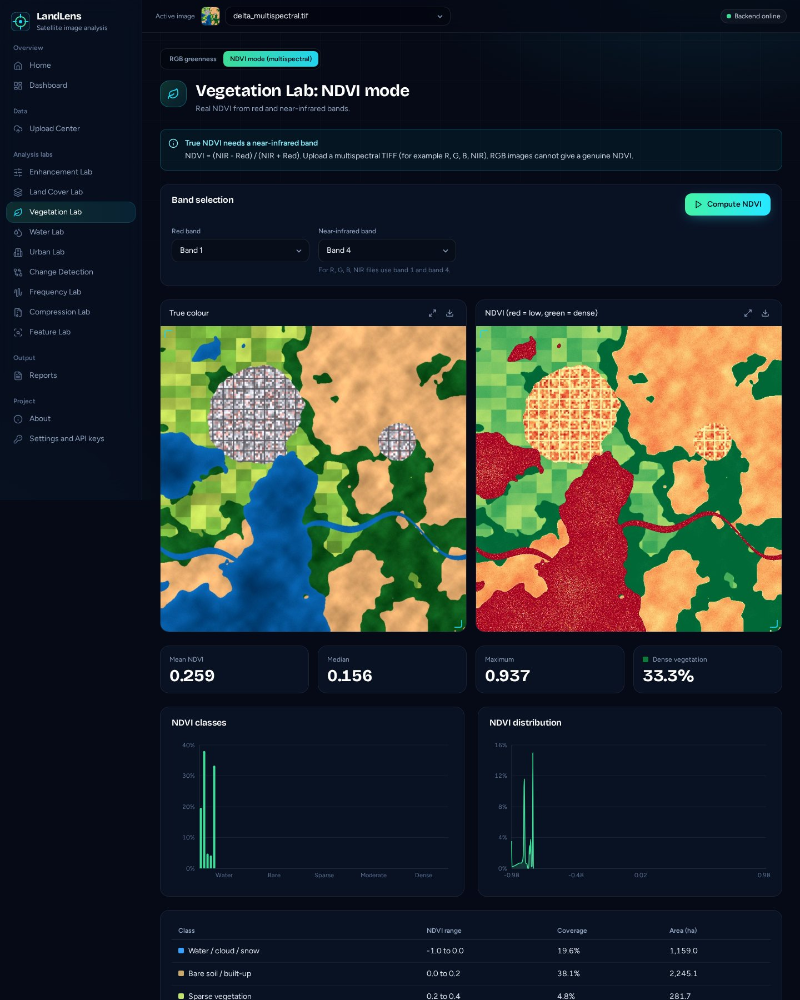 <br> **Vegetation Lab, NDVI mode** on a 4-band file |
| 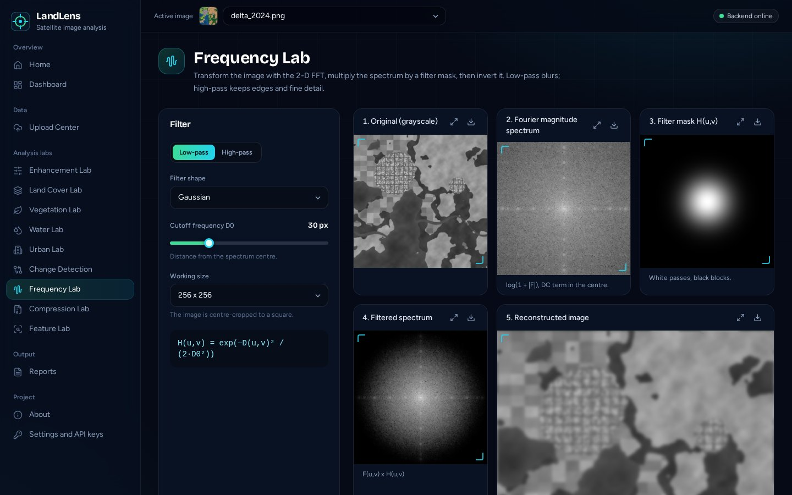 <br> **Frequency Lab:** spectrum, filter mask and reconstruction | 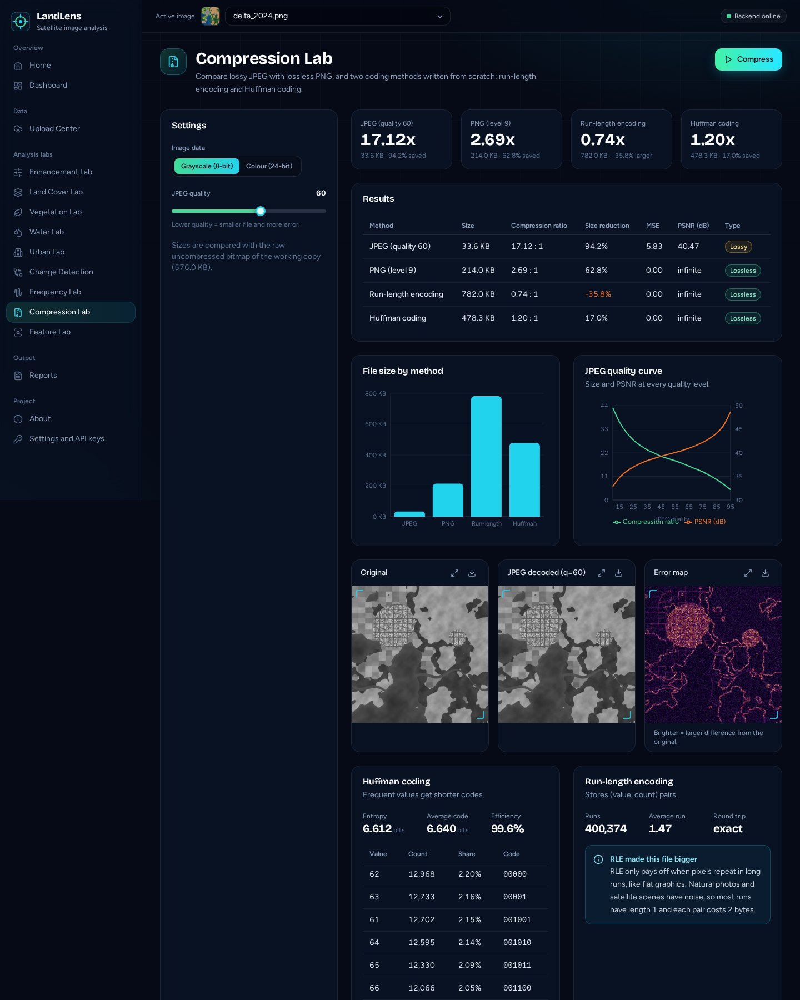 <br> **Compression Lab:** JPEG, PNG, RLE, Huffman |
| 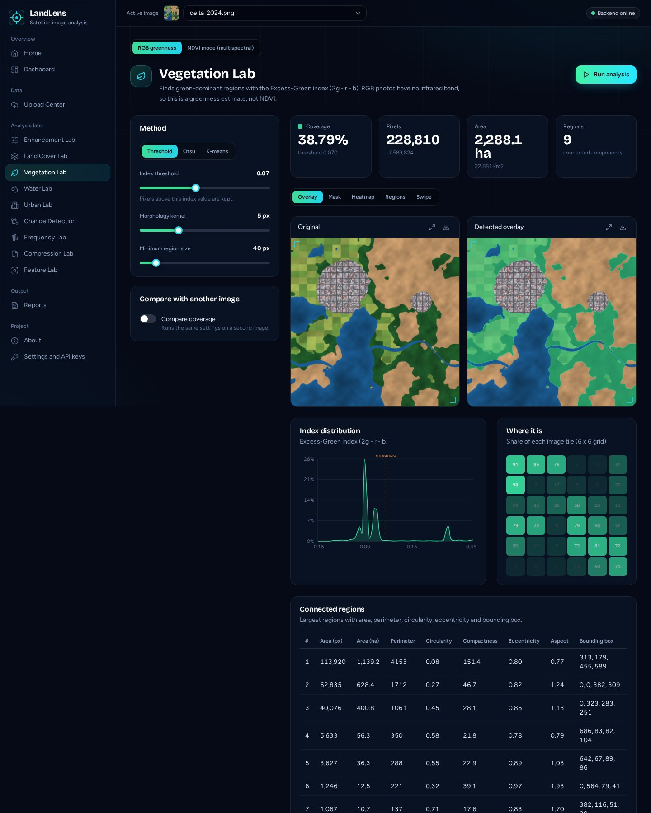 <br> **Vegetation Lab:** mask, heatmap, regions | 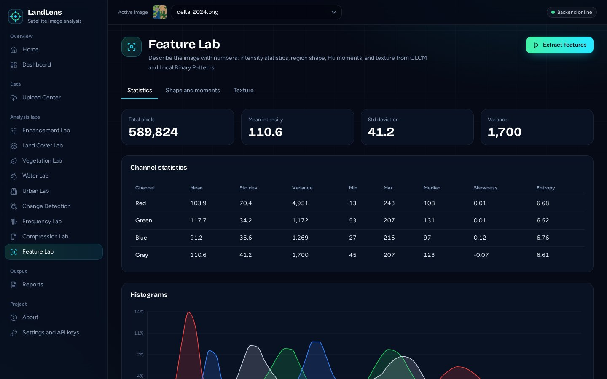 <br> **Feature Lab:** statistics, shape, texture |
| 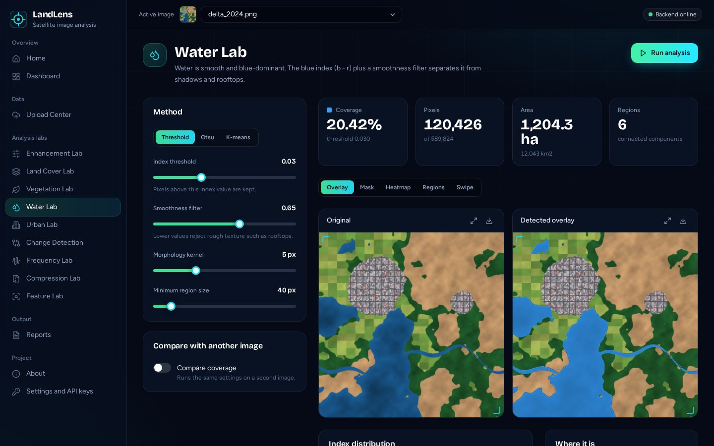 <br> **Water Lab** | 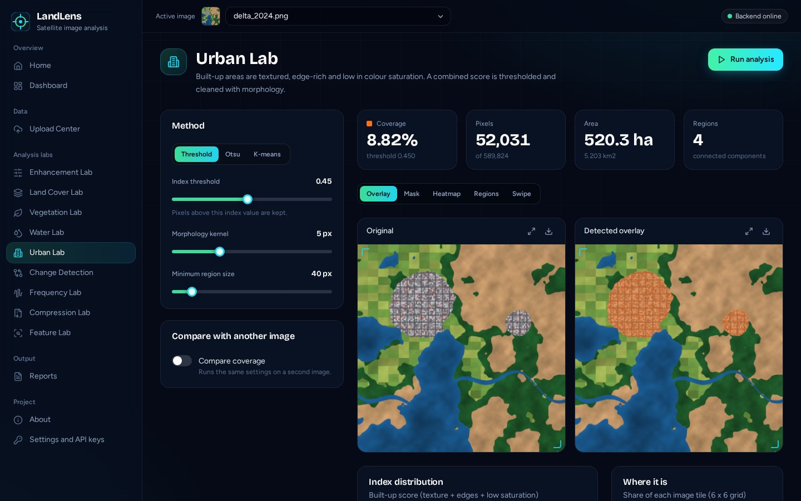 <br> **Urban Lab** |
| 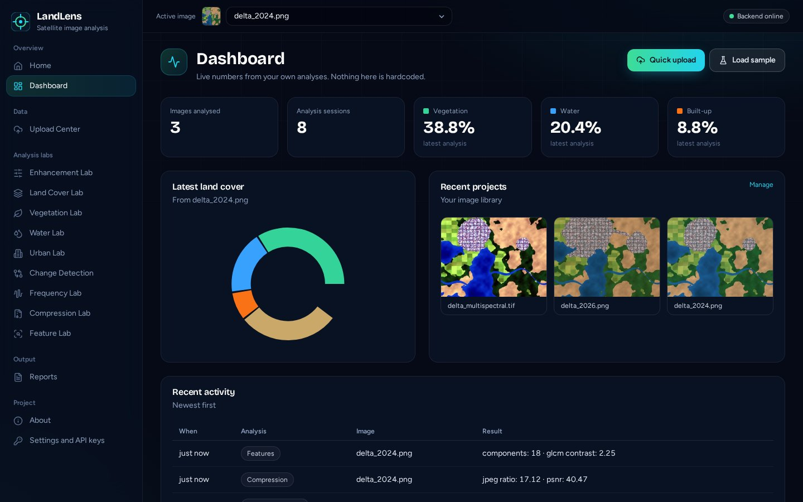 <br> **Dashboard** | 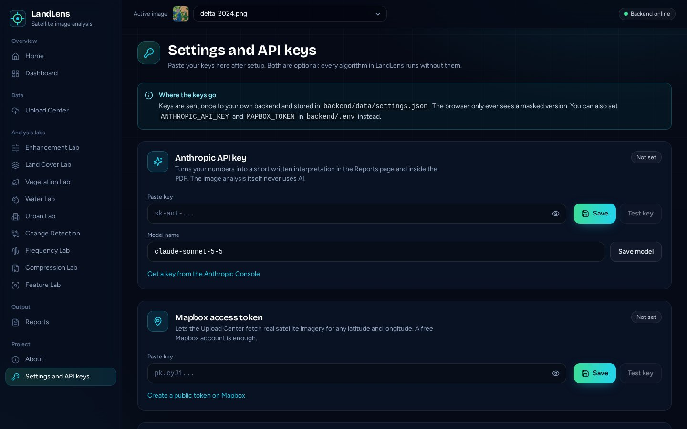 <br> **Settings and API keys** |

---

## Quick start

### Requirements

- **Python 3.10 or newer** (tested on 3.12)
- About 1 GB of free disk space for packages
- A modern browser
- **Node.js 18 or newer** is needed only if you want to edit the frontend. The built frontend is already included in `frontend/dist`.

### Option 1: one command

**Windows:** double-click `start.bat`
**macOS / Linux:**

```bash
chmod +x start.sh
./start.sh
```

Then open **http://localhost:8000**. The first start installs the Python packages, which takes a few minutes.

### Option 2: manual

```bash
cd backend
python -m venv venv

# Windows
venv\Scripts\activate
# macOS / Linux
source venv/bin/activate

pip install -r requirements.txt
uvicorn app.main:app --port 8000
```

Open **http://localhost:8000**. Interactive API docs are at **http://localhost:8000/docs**.

### Your first run (2 minutes)

1. On the Home page click **Try it with sample imagery**. This loads a 2024 and a 2026 scene.
2. In **Land Cover Lab** press **Run classification**.
3. Open **Change Detection** and press **Detect changes**.
4. Open **Reports** and download the PDF.

No account, database or key is needed for any of this.

---

## API keys (optional)

LandLens works fully without any key. Two optional extras use outside services:

| Key | Enables | Get it |
|---|---|---|
| **Anthropic API key** | A short written interpretation of your results in Reports and in the PDF | https://console.anthropic.com/settings/keys |
| **Mapbox access token** (public, starts with `pk.`) | Fetching satellite imagery by latitude and longitude in the Upload Center | https://account.mapbox.com/access-tokens/ |

### Where to paste them

**In the app (easiest):** open **Settings and API keys** in the sidebar, paste the key, press **Save**, then **Test key**. No restart is needed.

**In a file:** copy `backend/.env.example` to `backend/.env` and fill it in, then restart the backend:

```env
ANTHROPIC_API_KEY=sk-ant-...
ANTHROPIC_MODEL=claude-sonnet-5-5
MAPBOX_TOKEN=pk.eyJ1...
```

Keys are stored only on your machine (`backend/data/settings.json` or `backend/.env`). The browser only ever receives a masked version. Both locations are in `.gitignore`. **Never commit them.** Anthropic API usage is billed separately from a Claude chat subscription. Follow Mapbox's terms when using its imagery.

---

## How to use each page

### Upload Center
Drag images into the dashed box or click to browse. Several files can be uploaded at once (JPG, JPEG, PNG, TIFF, GeoTIFF, up to 60 MB each). The **Image inspector** shows size, channels, pixel count, metadata and per-channel statistics. The **Library** lets you select, download or delete images. The selected image becomes the **active image** shown in the top bar and used by every lab. The **Sample imagery** card loads the built-in scenes, and **Fetch by coordinates** (needs a Mapbox token) downloads a satellite tile for a latitude, longitude, zoom and size.

### Enhancement Lab
Pick one of 12 algorithms. The sliders for that algorithm appear and the result updates as you drag. Use **Swipe** for a wipe comparison. The histogram card shows original versus processed intensity, and the tiles show mean, standard deviation and entropy before and after. Brightness and contrast sliders apply on top of any algorithm.

### Land Cover Lab
Set `k` (number of K-means clusters, default 8), the morphology kernel and the minimum region size, optionally set metres per pixel, then press **Run classification**. Views: overlay, land-cover map, swipe and region boxes. You get class tiles (percent, hectares, pixels), a donut chart, bar chart, downloadable binary masks, a cluster table showing how each colour cluster was named, and the largest connected regions per class.

### Vegetation, Water and Urban Labs
Choose a method:
- **Threshold:** pixels whose index is above your slider value.
- **Otsu:** the threshold is picked automatically from the index histogram.
- **K-means:** keeps the matching class from the land-cover clustering.

You get coverage, pixels, hectares, region count, overlay, mask, heatmap, region boxes, a swipe view, an index histogram with the threshold marked, a 6 x 6 tile map showing where the class is concentrated, and a table of regions with area, perimeter, circularity, compactness, eccentricity, aspect ratio and bounding box. Turn on **Compare coverage** to run the same settings on a second image and see the difference in percentage points.

**NDVI mode** (Vegetation Lab, second tab) needs a multispectral TIFF with at least 4 bands. Choose the red and near-infrared bands (for R, G, B, NIR files: band 1 and band 4). You get an NDVI map, mean, median and maximum, five NDVI classes, a histogram and an area table. Use the built-in 4-band sample to try it.

### Change Detection
The active image is **Image A** (earlier). Choose **Image B** (later). Options: registration on or off, histogram matching, resampling method (nearest neighbour, bilinear, bicubic), Otsu or manual threshold, morphology kernel and minimum change size. Results: changed percent, changed hectares, number of changed regions, the registration shift found, swipe view, change overlay, difference heatmap, mask, region boxes, a land-cover comparison chart, a coverage shift table and the biggest class transitions (for example vegetation to built-up).

### Frequency Lab
Choose low-pass or high-pass, then Ideal, Butterworth or Gaussian, a cutoff frequency and (for Butterworth) an order. The page shows the five stages: original, magnitude spectrum, filter mask, filtered spectrum and reconstructed image, plus the filter formula, the percentage of spectrum energy kept, a radial spectrum profile and a DFT versus FFT timing and error comparison.

### Compression Lab
Choose grayscale or colour data and a JPEG quality, then press **Compress**. You get a table with size, compression ratio, size reduction, MSE and PSNR for JPEG, PNG, run-length encoding and Huffman coding, a size chart, a JPEG quality curve, the decoded JPEG with an error map, Huffman entropy, average code length, efficiency and the most frequent codes, and RLE run statistics. RLE often makes photographs larger, and the page explains why.

### Feature Lab
Press **Extract features**. Three tabs: **Statistics** (per-channel mean, standard deviation, variance, min, max, median, skewness, entropy, histograms), **Shape and moments** (region descriptors, bounding boxes, Hu moments per class) and **Texture** (GLCM properties overall and per class, Local Binary Pattern histogram and image).

### Reports
Pick the number of clusters, optionally include change detection with a second image, optionally add an AI interpretation, then **Download PDF report** or **Export CSV**. The page also shows your **analysis history** (downloadable as CSV, clearable).

The PDF contains: title and image details, resolution and channel statistics, original and enhanced image, segmentation with charts and area table, vegetation, water and built-up statistics, largest regions with shape features, change detection (optional), histogram, algorithms and parameters, AI interpretation (optional), and conclusion and limitations.

---

## Algorithms and formulas

| Area | Method |
|---|---|
| Grayscale | `Y = 0.299 R + 0.587 G + 0.114 B` |
| Negative | `s = 255 - r` |
| Log transform | `s = 255 * log(1 + c r/255) / log(1 + c)` |
| Gamma | `s = 255 (r/255)^gamma` |
| Contrast stretch | Linear map of the chosen low and high percentiles to 0-255 |
| Histogram equalization | CDF mapping applied to luminance (YCrCb) |
| CLAHE | Contrast-limited adaptive equalization on Lab lightness, configurable clip limit and tile grid |
| Spatial filters | Gaussian, median and box (mean) with an adjustable kernel |
| Sharpening | Sobel: `g = f + a * |grad f|`. Laplacian: `g = f - a * lap f` |
| Greenness index | Excess-Green on chromatic coordinates: `ExG = 2g - r - b` |
| Water index | Blue dominance: `b - r`, with a local-standard-deviation smoothness filter |
| Built-up score | `0.45 texture + 0.30 edge density + 0.25 (1 - saturation)` |
| NDVI | `(NIR - Red) / (NIR + Red)` for multispectral input only |
| Land cover | K-means on Lab colour plus local texture, clusters named by colour and texture rules |
| Thresholding | Fixed threshold or Otsu's method |
| Morphology | Opening, closing and small-region removal |
| Regions | 8-connected components, area, perimeter, circularity `4 pi A / P^2`, compactness `P^2 / A`, eccentricity, aspect ratio, bounding box |
| Registration | ECC alignment (translation and rotation) |
| Resampling | Nearest neighbour, bilinear, bicubic |
| Normalisation | Histogram matching of image B to image A |
| Change measure | Euclidean distance in Lab colour space, thresholded and cleaned with morphology |
| Transitions | Cross-tabulation of per-pixel classes from both dates (both clustered together so labels match) |
| Frequency domain | 2-D FFT with centred spectrum, `H(u,v)` masks: ideal, Butterworth `1/(1+(D/D0)^(2n))`, Gaussian `exp(-D^2 / 2 D0^2)`, high-pass as `1 - H` |
| DFT | Direct matrix DFT compared against the FFT |
| Compression | JPEG and PNG via OpenCV. RLE and Huffman coding implemented from scratch with round-trip checks |
| Quality metrics | `MSE`, `PSNR = 10 log10(255^2 / MSE)`, compression ratio, size reduction |
| Texture | GLCM (32 levels, distances 1 and 2, four angles): contrast, dissimilarity, homogeneity, energy, correlation, ASM. Uniform LBP with 8 neighbours at radius 1 |
| Shape | Hu's seven moment invariants |

---

## How accurate is it?

The built-in samples are **computer-generated scenes with known ground truth**, so accuracy can be measured exactly. On them (rule-based labs, default thresholds):

| Scene | Class | Estimated | Truth |
|---|---|---|---|
| River delta 2024 | Vegetation | 38.8 % | 37.3 % |
| | Water | 20.4 % | 21.0 % |
| | Built-up | 8.8 % | 8.9 % |
| River delta 2026 | Vegetation | 32.9 % | 31.6 % |
| | Water | 17.8 % | 17.9 % |
| | Built-up | 19.5 % | 19.7 % |

Image registration recovered a planted 5 px / 4 px shift to within about half a pixel.

Please read these numbers for what they are:

- They show the **code works**. They do not show it will be this accurate on real satellite photos. Real scenes have shadows, clouds, haze, mixed pixels and seasonal colour changes.
- The K-means land-cover percentages are close for vegetation and water but less exact for small classes, and the built-up share was underestimated in the joint two-date clustering. The **direction** of change was correct, the magnitudes are approximate.
- There is no automated test suite yet. Checks so far were scripted runs against every endpoint and the sample scenes.

---

## Architecture

```
 Browser (React + Vite + Tailwind + Recharts)
        |   JSON over HTTP  (/api/...)
        v
 FastAPI app  (backend/app/main.py)
        |
        +-- storage.py       images, settings, history as plain files
        +-- samples.py       built-in demo scenes
        +-- imaging/         enhance, landcover, change, frequency,
        |                    compression, features, report (PDF/CSV)
        +-- ai.py            optional Anthropic call (needs a key)
        |
        v
 backend/data/   uploads/, samples/, settings.json, history.json
```

- **No database.** Everything is stored as files in `backend/data/`.
- **Working copy.** Each image is analysed on a copy of at most 1100 px on its longest side, so labs respond in about a second on a normal laptop. The full-resolution original is kept for download and metadata.
- **Single server in production.** The backend also serves the built frontend, so one command runs the whole app.
- **Hash routing.** The frontend uses hash URLs (`/#/landcover`), so it works on any static host without extra rewrite rules.

---

## Project structure

The project folder is named `terrascope` in the zip. You can rename it freely.

```
terrascope/
├── README.md
├── start.sh / start.bat               one-command launchers
├── docs/screenshots/                  images used in this README
├── backend/
│   ├── requirements.txt
│   ├── .env.example                   copy to .env to add keys
│   ├── data/                          created at runtime (git-ignored)
│   └── app/
│       ├── main.py                    all API routes
│       ├── storage.py                 images, settings, history
│       ├── samples.py                 generated demo scenes
│       ├── ai.py                      optional AI interpretation
│       ├── util.py                    JSON cleaning, image encoding, class colours
│       └── imaging/
│           ├── core.py                indices, texture, morphology, components, overlays
│           ├── enhance.py             12 enhancement algorithms
│           ├── landcover.py           K-means land cover, vegetation/water/urban labs, NDVI
│           ├── change.py              registration, differencing, transitions
│           ├── frequency.py           DFT/FFT and frequency filters
│           ├── compression.py         JPEG, PNG, RLE, Huffman
│           ├── features.py            statistics, shape, Hu, GLCM, LBP
│           └── report.py              analysis pipeline, PDF and CSV builders
└── frontend/
    ├── package.json, vite.config.js, tailwind.config.js
    ├── dist/                          prebuilt app served by the backend
    └── src/
        ├── App.jsx, main.jsx, api.js, store.jsx, hooks.js, index.css
        ├── components/                Layout, UI kit, charts, compare slider, tables
        └── pages/                     Home, Dashboard, Upload, Enhancement, LandCover,
                                       MaskLabs (Vegetation, Water, Urban), Change,
                                       Frequency, Compression, Features, Reports,
                                       About, Settings
```

---

## REST API reference

Base URL `http://localhost:8000/api`. Interactive docs: `http://localhost:8000/docs`.

| Method | Endpoint | Purpose |
|---|---|---|
| GET | `/health` | Service status |
| GET | `/dashboard` | Totals, latest coverage, recent activity |
| GET / POST | `/settings` | Read (masked) or save keys and default resolution |
| POST | `/settings/test` | Test a saved key (`{"which": "anthropic" \| "mapbox"}`) |
| GET | `/images` | List the image library |
| POST | `/images/upload` | Upload an image (multipart field `file`) |
| GET | `/images/{id}` | Image metadata |
| GET | `/images/{id}/file` | Image as PNG (`?thumb=1` thumbnail, `?download=1` attachment) |
| DELETE | `/images/{id}` | Delete an image |
| GET | `/samples` | List built-in samples |
| POST | `/samples/{key}/load` | Load a sample into the library |
| POST | `/fetch-satellite` | Fetch a Mapbox satellite tile by coordinates |
| GET | `/enhance/ops` | Enhancement algorithms and their parameters |
| POST | `/enhance` | Run one enhancement |
| POST | `/landcover` | K-means land-cover classification |
| POST | `/mask/{vegetation\|water\|urban}` | Single-class lab (threshold, otsu or kmeans) |
| POST | `/ndvi` | True NDVI from a multispectral image |
| POST | `/change` | Change detection between two images |
| POST | `/frequency` | Frequency-domain filtering |
| POST | `/compression` | Compression comparison |
| POST | `/features` | Statistics, shape and texture features |
| POST | `/insights` | AI interpretation (needs Anthropic key) |
| GET | `/report/{id}` | PDF report (`?image_b_id=`, `?k=`, `?gsd=`, `?ai_insight=1`) |
| GET | `/export/csv/{id}` | CSV of all numbers |
| GET / DELETE | `/history` | Analysis history |
| GET | `/history/csv` | History as CSV |

Example:

```bash
# upload an image
curl -F "file=@my_scene.png" http://localhost:8000/api/images/upload

# classify it (replace IMAGE_ID with the id returned above)
curl -X POST http://localhost:8000/api/landcover \
     -H "Content-Type: application/json" \
     -d '{"image_id": "IMAGE_ID", "k": 8, "gsd": 10}'

# download a PDF report
curl -o report.pdf "http://localhost:8000/api/report/IMAGE_ID"
```

---

## Configuration and data storage

| Setting | Where | Default |
|---|---|---|
| Anthropic key and model | Settings page or `ANTHROPIC_API_KEY`, `ANTHROPIC_MODEL` | none, `claude-sonnet-5-5` |
| Mapbox token | Settings page or `MAPBOX_TOKEN` | none |
| Ground resolution (metres per pixel) | Settings page, or per lab | `10` |
| Data folder | `LANDLENS_DATA` environment variable | `backend/data` |
| Frontend API address | `VITE_API_URL` in `frontend/.env` | empty (same origin or Vite proxy) |

**Ground resolution** only changes area units (hectares, km²). Percentages never depend on it. Typical values: Sentinel-2 10 m, Landsat 30 m, aerial photos 0.3 to 1 m.

**What is stored:** uploaded images (PNG plus a JSON file each, and a `.npy` file for multispectral bands), `history.json` (last 500 analyses) and `settings.json`. Delete `backend/data/` to reset everything.

---

## Development

```bash
# terminal 1: backend with auto-reload
cd backend
source venv/bin/activate        # Windows: venv\Scripts\activate
uvicorn app.main:app --reload --port 8000

# terminal 2: frontend with hot reload
cd frontend
npm install
npm run dev                     # http://localhost:5173 (proxies /api to :8000)

# rebuild the production frontend (served by the backend on :8000)
npm run build
```

Adding a new lab: write the algorithm in `backend/app/imaging/`, add a route in `main.py`, add a method to `frontend/src/api.js`, create a page in `frontend/src/pages/` and register it in `App.jsx` and `components/Layout.jsx`.

---

## Deployment

**Single server (simplest).** Run the backend on any machine that has Python. It serves both the API and the built frontend on one port.

**Split hosting (free tiers).**
- *Backend on Render:* root directory `backend`, build command `pip install -r requirements.txt`, start command `uvicorn app.main:app --host 0.0.0.0 --port $PORT`.
- *Frontend on Vercel or Netlify:* root directory `frontend`, build command `npm run build`, output directory `dist`, and set `VITE_API_URL` to your backend URL.

Free instances sleep and lose their files on restart, so uploaded images and history are not permanent there. That is fine for a demo (reload the samples), but use a persistent disk for anything longer-lived. The API currently allows requests from any origin and has no login, so do not expose it publicly with real keys saved on the server.

---

## Troubleshooting

| Problem | Fix |
|---|---|
| "Backend offline" banner | The Python server is not running. Start it with `uvicorn app.main:app --port 8000` from the `backend` folder. |
| `pip install` fails | Use Python 3.10 to 3.12, upgrade pip (`python -m pip install --upgrade pip`) and retry inside a virtual environment. |
| Port 8000 already in use | Run on another port, for example `--port 8001`, and open that address. For the Vite dev server edit the proxy target in `frontend/vite.config.js`. |
| White page after `npm run build` | Open the app through the backend (http://localhost:8000), not by double-clicking `index.html`. |
| NDVI says there is no near-infrared band | NDVI needs a multispectral TIFF with at least 4 bands. JPG and PNG files cannot provide it. Load the built-in 4-band sample to try the feature. |
| "Mapbox rejected the token" | Use a public token (starts with `pk.`) and re-paste it in Settings. |
| AI insight fails with 401 or 404 | Re-paste the Anthropic key, or change the model name in Settings. |
| Very large image is slow | Analysis already uses a smaller working copy. Cropping the image to the area of interest helps further. |
| Reset everything | Stop the server and delete `backend/data/`. |

---

## Limitations

- **Estimates, not ground truth.** Classes come from colour, intensity and texture rules. Shadows, dark forest, wet soil, clouds and some rooftops can be mislabelled.
- **RGB greenness is not NDVI.** True NDVI needs red and near-infrared bands, which ordinary photos do not have.
- **A changed pixel is not always a real change.** Season, sun angle, haze and sensor differences alter pixel values. Registration and histogram matching reduce this but do not remove it.
- **Georeferencing is not used for analysis.** GeoTIFF tags are read and shown but the pixel grid is analysed as an image. Areas depend on the metres-per-pixel value you give.
- **Large images are analysed at reduced size** (longest side 1100 px).
- **Single user, no authentication.**
- Satellite imagery fetched through Mapbox is subject to Mapbox's terms.

---

## Roadmap

Ideas for future versions:

- Supervised land-cover classifier trained on a free labelled dataset (such as EuroSAT)
- More spectral indices (NDWI, NDBI) for multispectral and SWIR bands
- Cloud and shadow masking
- Georeferenced outputs (GeoTIFF masks, shapefile or GeoJSON of changed regions)
- Tile-based processing for very large images
- User accounts and a database for permanent online storage
- Automated tests and continuous integration
- Time-series analysis across more than two dates

---

